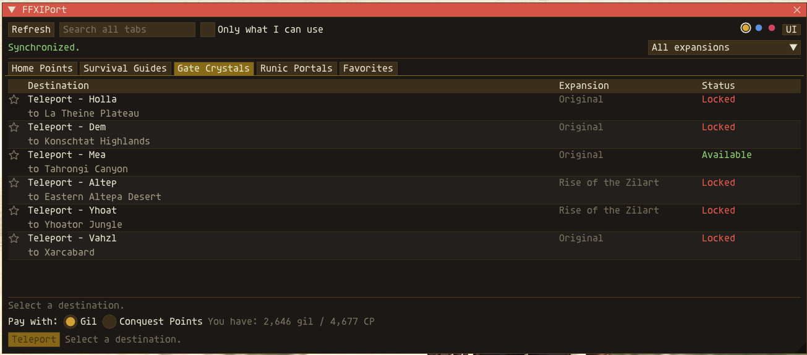
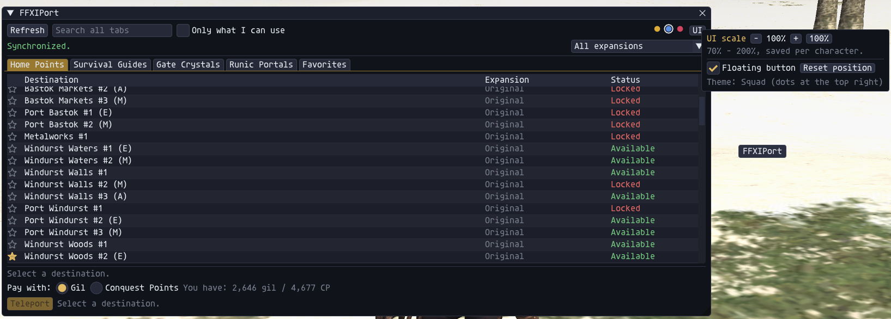
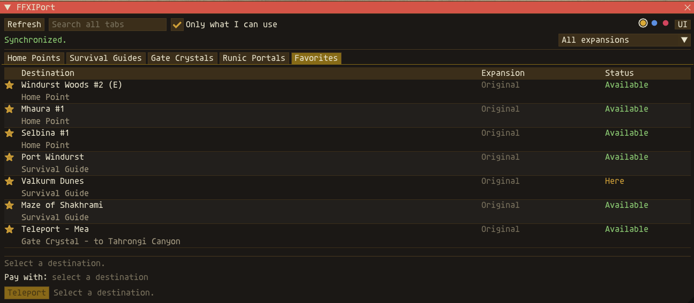

# FFXIPort 1.2.0

FFXIPort is a travel addon for **XI: Forever Offline**. It shows a window with
every Home Point, Survival Guide, Gate Crystal teleport and Runic Portal
your character can use, and lets you travel to them with one click: from
anywhere, paid with gil, Conquest Points or Imperial Standing, and free
within the same city.

It has two parts that work together:

* an **Ashita v4 addon** (the window and `/port` commands), and
* a **server module** (`fpxport.lua`) for the XI: Forever Offline /
  LandSandBoat-based server. It checks unlocks, prices and payment, and moves
  the character.

> **Independent project.** FFXIPort is an unofficial, independent fan project.
> It is not affiliated with, endorsed by or sponsored by Square Enix, the
> XI: Forever Offline project, the LandSandBoat project, the Ashita project or
> BG-Wiki. FINAL FANTASY is a registered trademark of Square Enix Holdings
> Co., Ltd. See [NOTICE.md](NOTICE.md).

## Features

* Five tabs: **Home Points** (104), **Survival Guides** (77), **Gate
  Crystals** (6), **Runic Portals** (6) and **Favorites**.
* Search across all tabs; filter to destinations you can use and, new in
  1.2.0, to one expansion (Original, Rise of the Zilart, Chains of Promathia,
  Treasures of Aht Urhgan).
* **Themes (1.2.0):** Classic (the original brown/gold, default), Squad (dark
  navy with gold, after the XI: Forever Offline Squad window) and Crimson (dark
  with muted burgundy). Switch with the three dots at the top right of the window.
* **UI scale (1.2.0):** 70 % to 200 % (text, buttons, rows, spacing) from the
  small **UI** button next to the dots.
* **Favourite star (1.2.0):** a drawn star; outline = not a favourite, filled
  = favourite.
* **Optional floating button (1.2.0):** a small draggable button (just the
  button, no panel around it) that opens and closes FFXIPort; off by default
  (turn it on under **UI**).
* Unlocks, prices and your gil / CP / Imperial Standing come from the server
  and refresh automatically after login, after reloading the addon and after
  every zone change.
* Server-authoritative pricing. The price shown is the price charged; if it
  changed in the meantime, the trip is refused and nothing is charged.
* Favorites and settings (tab, payment method, chat level, theme, UI scale,
  expansion filter, floating button and its position) are saved per character.
* Quiet chat: by default FFXIPort hides its own protocol traffic and command
  echoes and prints one line per trip.
* Location hints after some Home Point names: **E** (entrance/exit),
  **A** (Auction House), **M** (Mog House). All 35 were checked by hand against
  what FINAL FANTASY XI displays. They were originally compiled with the help
  of BG-Wiki (see NOTICE.md).

## Screenshots

**Classic — Gate Crystal teleports**

**Squad — UI customization and floating button**

**Crimson — Favorites across travel categories**

## Prices

| Destination | Gil | Alternative |
|-------------|----:|------------:|
| Home Point | 1,000 gil | 100 Conquest Points |
| Survival Guide | 1,000 gil | 100 Conquest Points |
| Gate Crystal teleport | 1,000 gil | 100 Conquest Points |
| Runic Portal | 1,000 gil | 100 Imperial Standing |
| **Within the same city** (e.g. Southern → Northern San d'Oria, Chateau d'Oraguille → Port San d'Oria, Heavens Tower → Windurst Woods) | **free** | **free** |

Choose the payment method in the window footer ("Pay with:"). Conquest Points
are those of your current nation. These are the defaults: **server operators
can change the prices** (and turn free same-city travel off) in `fpxport.lua`.
See [docs/SERVER-MODULE.md](docs/SERVER-MODULE.md#changing-prices-server-administrators-120).
The window always shows the server's current prices; players cannot change them.

## Requirements

* **Client:** Windows with FINAL FANTASY XI and **Ashita v4**.
* **Server:** an **XI: Forever Offline** (Phoenix / LandSandBoat-based) server
  where you can install a Lua module. FFXIPort 1.1.0 was tested in game on
  XI: Forever Offline, and the owner accepted 1.2.0 in game on its final release
  candidate (rc.2), which 1.2.0 is identical to apart from the version number
  and documentation. The exact Ashita and server builds used were not
  recorded (see [Known limitations](#known-limitations)).
* Install both parts from the **same FFXIPort release**. 1.1.0 and 1.2.0 use the
  same, unchanged FPX/1 protocol, so mixing them should work, but that
  combination has not been tested. Neither works with the previous FFXIPort
  server module.

## Installation

### Via the XI: Forever Offline launcher

FFXIPort is also listed under **OTHER** in the XI: Forever Offline launcher.
Select **Install** (or **Reinstall / update**), then enable FFXIPort under
**ADDONS → Addons to load**. The launcher states that the server component
ships with XI: Forever Offline. The launcher-provided version may be older
than the latest GitHub release.

### Manual installation

Short version below; full steps in [INSTALL.md](INSTALL.md).

1. **Server:** copy `server/modules/custom/late/fpxport.lua` into the server's
   `modules/custom/late/` folder and list it in `modules/init.txt`.
   **Disable the previous FFXIPort server module** (`custom/late/ffxiport.lua`)
   if you had it. If `init.txt` loads the whole folder, removing a line is not
   enough; move the old file out of `modules/` (see INSTALL.md). Restart the
   map server.
2. **Client:** copy the `FFXIPort` folder from `client/` into
   `Ashita/addons/`, replacing any older FFXIPort folder completely. Then type
   `/addon load FFXIPort` in game.

## Usage

| Command | What it does |
|---------|--------------|
| `/port` | Open or close the window |
| `/port open` / `/port close` | Open / close the window |
| `/port hp` · `sg` · `sp` · `rp` · `fav` | Open the window on a tab (Home Points, Survival Guides, Gate Crystals, Runic Portals, Favorites) |
| `/port sync` | Refresh unlocks, prices and balances now (same as the **Refresh** button) |
| `/port status` | Diagnostics: sync state, counts, balances, last trip |
| `/port catalog [hp\|sg\|sp\|rp\|find <text>]` | Inspect the destination catalogue |
| `/port chat quiet\|normal\|debug` | How much FFXIPort prints (saved per character; default quiet) |
| `/port chat trace on\|off` | Temporary read-only chat trace for troubleshooting |
| `/port raw on\|off` | Echo every protocol frame (troubleshooting) |
| `/ffxiport …` | Same as `/port …` |

To travel: select a destination, choose how to pay, press **Teleport**. Locked
destinations are shown but cannot be used. Click the star to add a destination
to **Favorites**. Themes, UI scale, the expansion filter and the floating button
are described in [docs/UI.md](docs/UI.md).

## Troubleshooting

| Symptom | What to check |
|---------|---------------|
| Window says "Waiting for sync"; `/port status` shows a timeout | Is `fpxport.lua` installed and listed in `init.txt`? Any errors in the map-server log? Is the old `ffxiport.lua` disabled? |
| "The server could not read an FFXIPort request" | Client and server are from different releases. Install both from the same package. |
| "Server protocol version mismatch" | Same cause. Automatic sync stops until both parts match. |
| Lines starting with `#fpx1` appear in chat | `/port status` should show "foreign: 0". If it doesn't, run `/port chat trace on` and `/port sync`, then report the trace; it shows the packet mode and sender. |
| "Travel refused: The price has changed" | Prices were refreshed. Check the new price and try again; nothing was charged. |
| "Payment/travel outcome UNCERTAIN" | Check your gil / CP / IS. The server logged a `CURRENCY INCIDENT` for the operator; please report it. |
| "N unlocked destination(s) are outside this catalogue's … scope" | Your character unlocked destinations from expansions after Treasures of Aht Urhgan, which FFXIPort does not list. `/port status` shows their ids. |
| Text does not get bigger with the UI scale | The options popover and `/port status` (line "UI:") say whether text scaling works in your client; sizes and spacing still scale. Please report it. |
| The floating button is off screen | Open `/port`, then **UI** -> **Reset position**. |

## Known limitations

* **Runic Portal travel and Imperial Standing payment have not been tested in
  game.** Tested in game on XI: Forever Offline: client/server communication,
  automatic and zone re-synchronization, free same-city travel, paid travel
  with gil and with Conquest Points, and hiding of protocol messages. Which
  destination categories were used in those trips was not recorded. Every
  category is covered by automated tests.
* Destinations in Wings of the Goddess, Seekers of Adoulin and later zones are
  not listed ([docs/CATALOGUE.md](docs/CATALOGUE.md)).
* Works only with the `fpxport.lua` server module of the same release.
* **In-game status of 1.2.0:** the owner's in-game acceptance of 1.2.0-rc.2
  covered the three themes, UI scaling, the expansion filter, favourite stars,
  the floating button (no outer panel; click and drag), per-character UI
  settings and existing travel. Not tested in game: changing server prices on
  a live server, and mixing 1.1.0 and 1.2.0 client and server (same protocol).
  See [docs/TEST-RESULTS-1.2.0.md](docs/TEST-RESULTS-1.2.0.md).
* Text scaling uses Ashita's ImGui 1.92 `PushFont(font, size)`. If a client's
  binding does not allow it, only sizes and spacing scale (reported in the UI).

## License

FFXIPort is free software, licensed GPL-3.0-only. See [LICENSE](LICENSE).
Copyright (C) 2026 wildthing. The server module contains factual destination
data from LandSandBoat (GPL-3.0). Third-party notices, trademarks and open
questions are in [NOTICE.md](NOTICE.md); provenance is in
[docs/PROVENANCE-M8.md](docs/PROVENANCE-M8.md).

The complete source, including tests, generators and design documents, is
published as the **source distribution** of each release.
